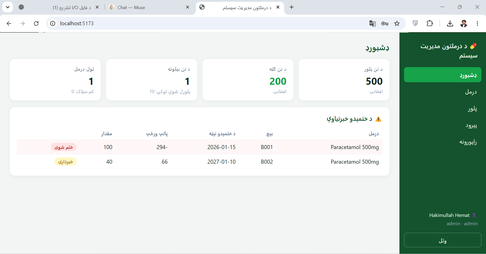
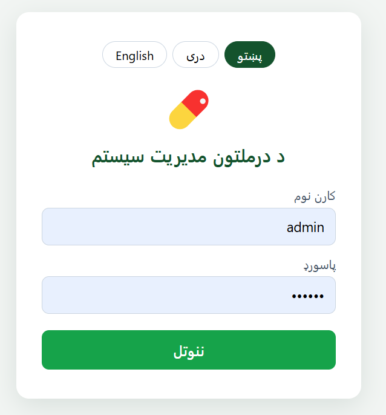
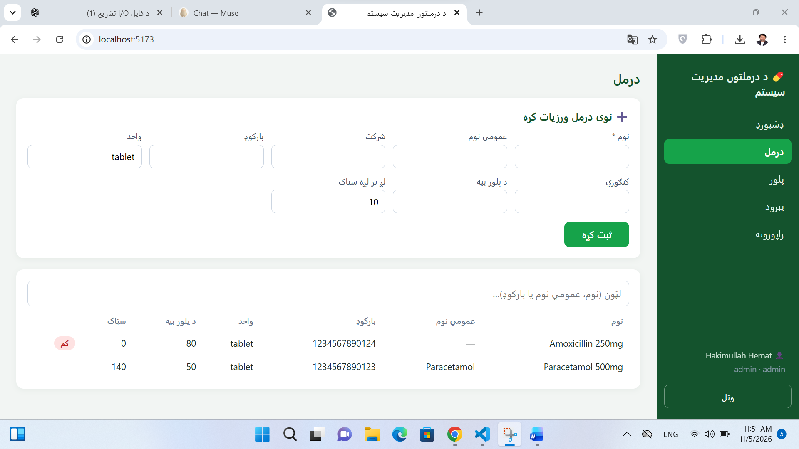
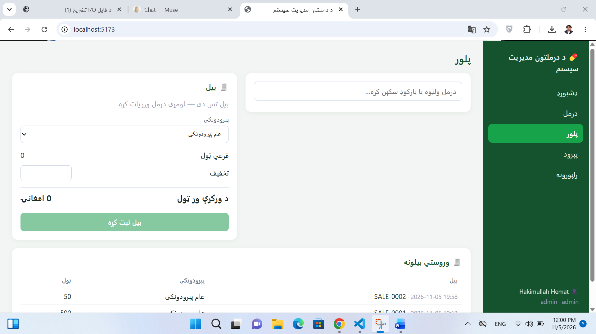
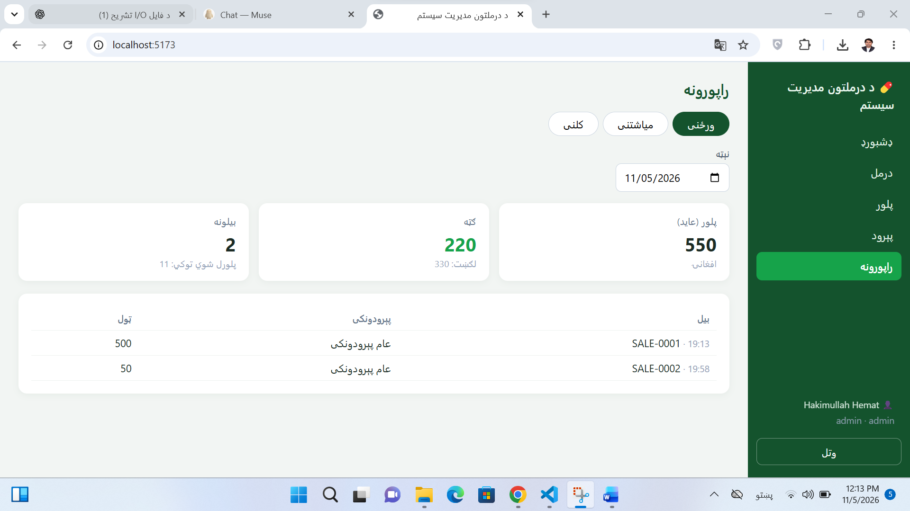

# Pharmacy Management System

A complete management system for a pharmacy — medicines and stock, purchases and supplier accounts, customers, a fast point-of-sale with credit sales and returns, and rich profit reports (daily to yearly, custom ranges, charts, Excel export and print/PDF) — built to run on the pharmacy's own computer, in **Pashto, Dari and English**.



## The problem

Many small pharmacies still track stock, expiry dates and daily profit in paper notebooks. Expired medicines get sold by mistake, stock counts drift away from reality, supplier and customer balances live in someone's memory, and the owner cannot answer a simple question at the end of the day: *what did we sell today, and what profit did we make?*

## The solution

A full-stack web application that runs locally (no internet needed) and handles the whole workflow:

- **Medicines & stock** — every medicine with its batches and expiry dates; entry by **barcode scanner or keyboard**, with an online barcode lookup that pre-fills name and company for new products; opening stock is recorded as a proper purchase, so the books are right from day one
- **Purchases** — stock enters only through purchases from suppliers, recorded batch by batch, with full history, search by invoice / supplier / date, a detail view, and **edit & delete** that move stock by differences only and refuse to touch units already sold
- **Returns to supplier** — stock can be sent back from a purchase's detail view; supplier balances are re-computed net of returns automatically
- **Purchase guards** — entering the same invoice number twice for one supplier raises a warning before saving (with a deliberate save-anyway), an expiry date that is close raises a warning, and an **already-expired medicine can no longer be recorded at all** — neither in a purchase nor as opening stock
- **Supplier accounts** — every supplier shows total purchases, total paid and the balance still owed; payments are recorded against the balance, never more than what is due
- **Point of sale** — scan a barcode and the medicine lands on the bill (the search box refocuses itself, so scanning needs no clicks); selling follows **FEFO** (first-expiry, first-out), and **expired batches can never be sold**
- **Printed receipts** — a clean 80 mm receipt with the pharmacy's name, phone and address; reprintable for any bill, any time
- **Credit (پور) sales** — a named customer can pay part now and the rest later; the bill shows its remaining balance, later payments are recorded against it, and every customer's total due is visible on the Customers page
- **Sales returns & void** — a bill can be corrected after the fact: returned items go back into the exact batch they were sold from (never more than was sold), or a mistaken bill can be **voided** in one click, returning everything to the shelf; returned and voided bills are marked in the list, and reports exclude them truthfully
- **Customers** — a register with search by name or phone, a full purchase history per customer, dues at a glance, and edit / soft-delete
- **Expiry dates page & write-off** — every batch in one list, flagged OK / warning / critical / expired with a per-medicine warning period (in months, default 3); expired stock is **written off** formally — quantity, reason and user recorded in a history — instead of silently disappearing
- **Reports** — **daily, weekly, monthly and yearly** reports plus a **custom date range**, with revenue, cost of goods, **real profit** (each sale keeps a snapshot of its batch cost, so reports stay correct even when prices change) and the **profit-margin %** on the summary cards
- **Charts & breakdowns** — a bar chart of revenue and profit per day or month (negative-profit days turn red), **Top medicines** by profit for every period, and **purchases per supplier** (bought, returned, net, paid) so both sides of the money are visible
- **Stock value report** — what the shelf is worth right now: cost value, sale value and expected profit per medicine, with the value of stock expiring within 90 days and of expired stock shown separately — the report that exposes medicines priced at or below cost
- **Print, PDF & Excel** — every report prints on A4 (or saves as PDF) with the pharmacy's header, and exports to **Excel (.xlsx)** with Summary, detail, Medicines and Purchases sheets; long tables sit in scroll boxes that show six records at a time
- **Settings & user management** — every user can change their own password and interface language; admins manage the pharmacy's branch details and user accounts (roles: admin / pharmacist / cashier, with activate / deactivate)
- **Backup & restore** — admins can download a full database backup and restore from one, right inside the app
- **Three languages** — Pashto (default, RTL), Dari (RTL) and English (LTR), switchable at any time; phone numbers are validated system-wide (exactly 10 digits)

## Screenshots

| Login (Pashto) | Medicines |
| --- | --- |
|  |  |

| Point of sale | Reports |
| --- | --- |
|  |  |

## Tech stack

| Layer | Technology |
| --- | --- |
| Frontend | React 18, TypeScript, Vite |
| Backend | Node.js, Express |
| Database | MySQL 8 (InnoDB, 15 tables) |
| Reports export | ExcelJS (server-generated .xlsx) |
| Auth | JWT + bcrypt password hashing, role-based access (admin / pharmacist / cashier) |

## Design decisions

- **Stock is a ledger, not a number.** Every stock movement is an append-only row in `stock_transactions`; batch quantities are a cache that can always be reconciled against the ledger.
- **Money is computed, never typed twice.** Supplier dues, customer dues and report figures are always derived from the underlying documents (purchases, sales, payments, returns) — there is no editable "balance" field anywhere to drift out of sync.
- **Sales and purchases are single database transactions** — a bill is recorded completely or not at all, so a crash can never corrupt stock.
- **FEFO allocation with row locks** — the earliest-expiring sellable batch is always sold first, and expired stock is excluded in the query itself, not just hidden in the UI.
- **Expiry is guarded at every door** — it cannot be *entered* (past dates are rejected), it is *watched* (per-medicine warning windows on the dashboard and the expiry page), it cannot be *sold* (FEFO skips it), and it leaves the books only through a recorded *write-off*.
- **Branch-scoped data** — every record carries a `branch_id` taken from the user's login token (never from the request), so the same system serves one pharmacy or many branches without mixing data.
- **Backup that is actually tested** — an in-app `mysqldump` backup, with a restore into a separate test database verified end-to-end.

## Run it locally

**Prerequisites:** Node.js 20+ and MySQL 8.

```bash
git clone https://github.com/hakimullahhemat13/pharmacy-system.git
cd pharmacy-system
```

**1. Database** — create the database and load the schema:

```sql
CREATE DATABASE pharmacy_db CHARACTER SET utf8mb4 COLLATE utf8mb4_unicode_ci;
```

```bash
mysql -u root -p pharmacy_db < database/schema.sql
```

Create a dedicated app user (do not use root) and grant it access to `pharmacy_db`.

**2. Backend:**

```bash
cd server
copy .env.example .env   # then fill in DB_PASSWORD and a long JWT_SECRET
npm install
npm run dev              # http://localhost:5000  — check /api/health
```

**3. First admin user** (run once, from the `server` folder, with the
`ADMIN_USERNAME`, `ADMIN_FULL_NAME` and `ADMIN_PASSWORD` environment
variables set):

```bash
node scripts/create-admin.js
```

**4. Frontend:**

```bash
cd ../client
npm install
npm run dev              # http://localhost:5173
```

Log in with the admin user and the system is ready.

## API overview

| Area | Endpoints |
| --- | --- |
| Auth | `POST /api/auth/login`, `GET /api/auth/me` |
| Medicines | `GET/POST /api/medicines`, `PUT/DELETE /api/medicines/:id` (search + exact barcode lookup, opening stock) |
| Stock | `GET /api/stock`, `GET /api/stock/all-batches`, `POST /api/stock/batches/:batchId/write-off`, `GET /api/stock/write-offs` |
| Suppliers | `GET/POST /api/suppliers`, `GET/PUT /api/suppliers/:id`, `POST /api/suppliers/:id/payment` |
| Purchases | `GET/POST /api/purchases`, `GET/PUT/DELETE /api/purchases/:id`, `POST /api/purchases/:id/return` |
| Sales | `GET/POST /api/sales`, `POST /api/sales/:id/return`, `POST /api/sales/:id/payment`, `POST /api/sales/:id/void` |
| Customers | `GET/POST /api/customers`, `GET /api/customers/:id/history`, `PUT/DELETE /api/customers/:id` |
| Reports | `GET /api/reports/daily`, `/weekly`, `/monthly`, `/yearly`, `/range`, `/medicines`, `/purchases`, `/stock-value`, `GET /api/reports/export` (Excel) |
| Settings | `POST /api/settings/password`, `PUT /api/settings/language`, `GET/PUT /api/settings/branch`, `GET/POST /api/settings/users` |
| Backup | `GET /api/backup/download`, `POST /api/backup/restore` (admin only) |

## Status & roadmap

Phase 1 (local, single computer) is **complete and in daily-test use**: medicines, purchases with guards, supplier accounts, point of sale with receipts, credit sales, returns and voids, customers, expiry tracking with write-offs, reports with charts, per-period medicine and supplier breakdowns, a stock-value report, Excel export and print/PDF, settings with user management, and in-app backup & restore — all verified live, in three languages.

Planned next (Phase 2): optional online access and multi-branch synchronisation, and a mobile companion app.
