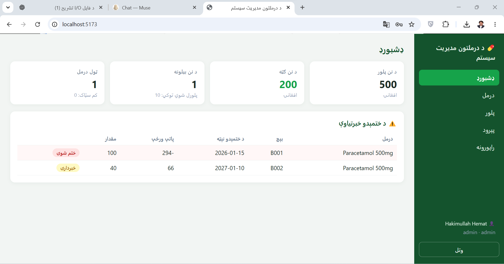
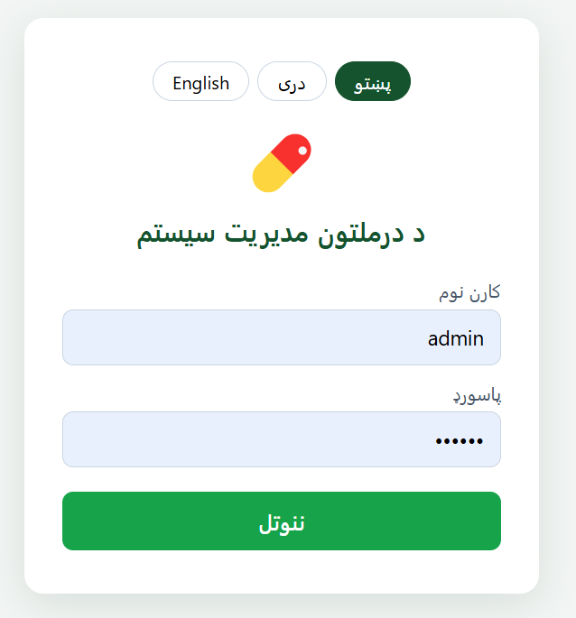
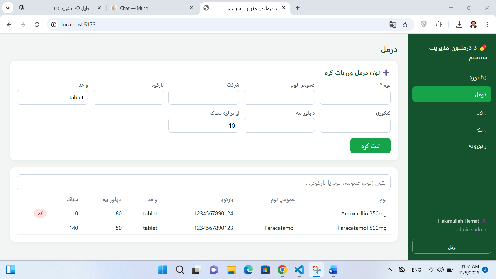
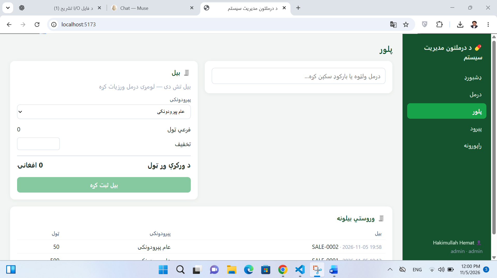
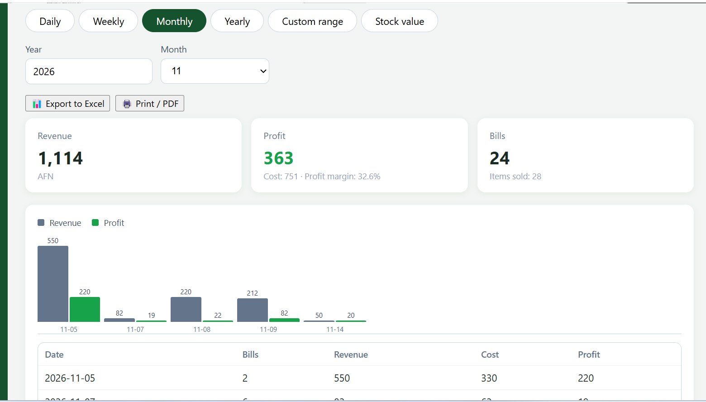

# Pharmacy Management System

A complete management system for a pharmacy — medicines and stock, purchases and supplier accounts, customers, a fast point-of-sale with credit sales and returns, and rich profit reports (daily to yearly, custom ranges, charts, Excel export and print/PDF) — built to run on the pharmacy's own computer, in **Pashto, Dari and English**.



## The problem

Many small pharmacies still track stock, expiry dates and daily profit in paper notebooks. Expired medicines get sold by mistake, stock counts drift away from reality, supplier and customer balances live in someone's memory, and the owner cannot answer a simple question at the end of the day: *what did we sell today, and what profit did we make?*

## The solution

A full-stack web application that runs locally (no internet needed) and handles the whole workflow:

- **Medicines & stock** — every medicine with its batches and expiry dates; entry by **barcode scanner or keyboard**, with an online barcode lookup that pre-fills name and company for new products; opening stock is recorded as a proper purchase, so the books are right from day one
- **Purchases** — stock enters only through purchases from suppliers, recorded batch by batch, with full history, search by invoice / supplier / date, a detail view, and **edit & delete** that move stock by differences only and refuse to touch units already sold
- **Returns to supplier** — stock can be sent back from a purchase's detail view; supplier balances are re-computed net of returns automatically
- **Purchase guards** — entering the same invoice number twice for one supplier raises a warning before saving (with a deliberate save-anyway), an expiry date that is close raises a warning, and an **already-expired medicine can no longer be recorded at all** — neither in a purchase nor as opening stock
- **Supplier accounts** — every supplier shows total purchases, total paid and the balance still owed; payments are recorded against the balance, never more than what is due. Suppliers can be **edited**, and **soft-deleted** (blocked while a balance is still owed; purchase history keeps showing the supplier's name)
- **Point of sale** — scan a barcode and the medicine lands on the bill (the search box refocuses itself, so scanning needs no clicks); selling follows **FEFO** (first-expiry, first-out), and **expired batches can never be sold**. Till shortcuts: **F2** focuses the search box, **Ctrl+Enter** completes the sale, **Esc** clears the search or closes a bill detail
- **Unknown barcodes** — scanning a barcode the system does not know offers to add it as a new medicine with the barcode already filled in (one click, or Enter) — no re-typing at the till
- **Printed receipts** — a clean 80 mm receipt with the pharmacy's name, phone and address, and the **seller's name**; reprintable for any bill, any time
- **Credit (پور) sales** — a named customer can pay part now and the rest later; the bill shows its remaining balance, later payments are recorded against it (including from the customer's history), and every customer's total due is visible on the Customers page
- **Sales returns & void** — a bill can be corrected after the fact: returned items go back into the exact batch they were sold from (never more than was sold), or a mistaken bill can be **voided** in one click, returning everything to the shelf; returned and voided bills are marked in the list, and reports exclude them truthfully
- **Customers** — a register with search by name or phone, a full purchase history per customer, dues at a glance, a With-due filter, and edit / soft-delete
- **Expiry dates page & write-off** — every batch in one list, flagged OK / warning / critical / expired with a per-medicine warning period (in months, default 3); expired stock is **written off** formally — quantity, reason and user recorded in a history — instead of silently disappearing. The list **prints on A4** with the pharmacy's letterhead and **exports to Excel**, matching the screen's filter and search — ready to hand to a supplier when near-expiry stock goes back
- **Seller attribution** — every sale, purchase and supplier payment is recorded against the user who is logged in, and the seller's name appears on bills, receipts, the dashboard and the daily report, so the owner always knows who sold what
- **Role-based access, enforced on the server** — a cashier sees only the Dashboard (own sales, no profit, stock value or chart), Sales (sell, and only their own bills, view-only), Customers (add and view) and Settings (language and own password); a pharmacist adds Medicines, Expiry dates, Purchases, Suppliers and Reports; an admin adds user management and Restore. Hiding a menu item alone is not the enforcement — the server refuses the forbidden actions too
- **Audit log** — every important action (sales, returns, payments, voids, purchases, write-offs, user changes, logins, backups, day closes) is recorded with the user, the time and a readable summary; an admin-only viewer with filters lives in Settings, and the log is append-only — nothing in it can be edited or deleted
- **Day Close & reconciliation** — the end-of-day panel on the Daily report reconciles the cash drawer (till + customer payments − refunds − paid to suppliers = expected cash) against the counted cash, and checks the stock (units sold vs the ledger, and every batch's quantity against the ledger). Closing the day **locks it**: no new sales, returns, payments, purchases or write-offs can touch that date until an admin reopens it. Every close and reopen is written to the audit log
- **Reports** — **daily, weekly, monthly and yearly** reports plus a **custom date range**, with revenue, cost of goods, **real profit** (each sale keeps a snapshot of its batch cost, so reports stay correct even when prices change) and the **profit-margin %** on the summary cards; the monthly report **compares with the previous month** (revenue, profit, bills, items — signed change and %, in the page, the print sheet and the Excel export)
- **Charts & breakdowns** — a bar chart of revenue and profit per day or month (negative-profit days turn red), **Top medicines** by profit for every period, and **purchases per supplier** (bought, returned, net, paid) so both sides of the money are visible
- **Stock value report** — what the shelf is worth right now: cost value, sale value and expected profit per medicine, with the value of stock expiring within 90 days and of expired stock shown separately — the report that exposes medicines priced at or below cost
- **Print, PDF & Excel** — every report prints on A4 (or saves as PDF) with the pharmacy's letterhead, and exports to **Excel (.xlsx)** with Summary, detail, Medicines and Purchases sheets; printed and on-screen bills show Total / Returned / Net per bill, so a returned bill can never be misread; long tables sit in scroll boxes that show six records at a time
- **Settings & user management** — every user can change their own password and interface language; admins manage the pharmacy's branch details and user accounts (roles: admin / pharmacist / cashier, with activate / deactivate, soft-delete — self-delete and deleting the last active admin are blocked — and admin password reset; passwords are bcrypt hashes and can never be read, only reset)
- **Backup & restore** — every logged-in user can **download** a full database backup, choosing where to save it in the browser's Save dialog (file names carry the date and time, so backups never overwrite each other); **restoring** a backup stays admin-only, in the menu and on the server. An **automatic backup** runs once a day (to the D: drive when one exists, otherwise to the project's backups folder), keeps the last 7 days, prunes older files itself, and can be run on demand from the Backup page
- **Automated tests** — `npm test` runs the API suite against a separate test database, checking FEFO selling, returns, report math, day close, roles and the audit log — so future changes cannot silently break the money math
- **Three languages** — Pashto (default, RTL), Dari (RTL) and English (LTR), switchable at any time; phone numbers are validated system-wide (exactly 10 digits)

## Screenshots

| Login (Pashto) | Medicines |
| --- | --- |
|  |  |

| Point of sale | Reports |
| --- | --- |
|  |  |

## Tech stack

| Layer | Technology |
| --- | --- |
| Frontend | React 18, TypeScript, Vite |
| Backend | Node.js, Express |
| Database | MySQL 8 (InnoDB, 17 tables) |
| Reports export | ExcelJS (server-generated .xlsx) |
| Auth | JWT + bcrypt password hashing, role-based access (admin / pharmacist / cashier) |
| Tests | Node's built-in test runner — no extra packages |

## Design decisions

- **Stock is a ledger, not a number.** Every stock movement is an append-only row in `stock_transactions`; batch quantities are a cache that can always be reconciled against the ledger.
- **Money is computed, never typed twice.** Supplier dues, customer dues and report figures are always derived from the underlying documents (purchases, sales, payments, returns) — there is no editable "balance" field anywhere to drift out of sync.
- **Sales and purchases are single database transactions** — a bill is recorded completely or not at all, so a crash can never corrupt stock.
- **FEFO allocation with row locks** — the earliest-expiring sellable batch is always sold first, and expired stock is excluded in the query itself, not just hidden in the UI.
- **Expiry is guarded at every door** — it cannot be *entered* (past dates are rejected), it is *watched* (per-medicine warning windows on the dashboard and the expiry page), it cannot be *sold* (FEFO skips it), and it leaves the books only through a recorded *write-off*.
- **A closed day is a locked day.** Day Close snapshots the cash reconciliation and the stock check, then the server refuses any write touching that date until an admin reopens it — yesterday's report can never quietly change.
- **Every action leaves a trace.** The audit log records who did what and when, append-only, so disputes and mistakes can always be reconstructed.
- **Branch-scoped data** — every record carries a `branch_id` taken from the user's login token (never from the request), so the same system serves one pharmacy or many branches without mixing data.
- **Backup that is actually tested** — an in-app `mysqldump` backup, with a restore into a separate test database verified end-to-end, plus an automatic daily backup that keeps itself tidy.

## Run it locally

**Prerequisites:** Node.js 20+ and MySQL 8.

```bash
git clone https://github.com/hakimullahhemat13/pharmacy-system.git
cd pharmacy-system
```

**1. Database** — create the database and load the schema:

```sql
CREATE DATABASE pharmacy_db CHARACTER SET utf8mb4 COLLATE utf8mb4_unicode_ci;
```

```bash
mysql -u root -p pharmacy_db < database/schema.sql
```

Create a dedicated app user (do not use root) and grant it access to `pharmacy_db`.

**2. Backend:**

```bash
cd server
copy .env.example .env   # then fill in DB_PASSWORD and a long JWT_SECRET
npm install
npm run dev              # http://localhost:5000  — check /api/health
```

**3. First admin user** (run once, from the `server` folder, with the
`ADMIN_USERNAME`, `ADMIN_FULL_NAME` and `ADMIN_PASSWORD` environment
variables set):

```bash
node scripts/create-admin.js
```

**4. Frontend:**

```bash
cd ../client
npm install
npm run dev              # http://localhost:5173
```

Log in with the admin user and the system is ready.

**5. Automated tests** (optional, from the `server` folder) — one-time
setup creates the separate test database (as root):

```bash
mysql -u root -p -e "SOURCE server/tests/setup-test-db.sql"
```

then:

```bash
npm test
```

The suite starts the real server on port 5011 against `pharmacy_db_test`
and drives it over HTTP. The real `pharmacy_db` is never touched.

## API overview

| Area | Endpoints |
| --- | --- |
| Auth | `POST /api/auth/login`, `GET /api/auth/me` |
| Medicines | `GET/POST /api/medicines`, `PUT/DELETE /api/medicines/:id` (search + exact barcode lookup, opening stock) |
| Stock | `GET /api/stock`, `GET /api/stock/all-batches`, `GET /api/stock/expiry-export` (Excel), `POST /api/stock/batches/:batchId/write-off`, `GET /api/stock/write-offs` |
| Suppliers | `GET/POST /api/suppliers`, `GET/PUT/DELETE /api/suppliers/:id`, `POST /api/suppliers/:id/payment` |
| Purchases | `GET/POST /api/purchases`, `GET/PUT/DELETE /api/purchases/:id`, `POST /api/purchases/:id/return` |
| Sales | `GET/POST /api/sales`, `POST /api/sales/:id/return`, `POST /api/sales/:id/payment`, `POST /api/sales/:id/void` |
| Customers | `GET/POST /api/customers`, `GET /api/customers/:id/history`, `PUT/DELETE /api/customers/:id` |
| Reports | `GET /api/reports/daily`, `/weekly`, `/monthly`, `/yearly`, `/range`, `/medicines`, `/purchases`, `/stock-value`, `GET /api/reports/export` (Excel), `GET/POST /api/reports/day-close`, `POST /api/reports/day-close/reopen` |
| Settings | `POST /api/settings/password`, `PUT /api/settings/language`, `GET/PUT /api/settings/branch`, `GET/POST /api/settings/users`, `DELETE /api/settings/users/:id`, `POST /api/settings/users/:id/reset-password`, `GET /api/settings/audit-log` |
| Backup | `GET /api/backup/download` (every logged-in user), `POST /api/backup/restore` (admin only), `GET/PUT /api/backup/auto/config`, `POST /api/backup/auto/run`, `GET /api/backup/auto/files` (admin only) |

## Status & roadmap

Phase 1 (local, single computer) is **complete and in daily-test use**: medicines, purchases with guards, supplier accounts, point of sale with receipts, credit sales, returns and voids, customers, expiry tracking with write-offs, reports with charts, per-period medicine and supplier breakdowns, a stock-value report, Excel export and print/PDF, seller attribution, server-enforced role-based access, settings with user management (including user delete and admin password reset), in-app backup for every user with admin-only restore, **automatic daily backup**, an **audit log**, **Day Close with cash and stock reconciliation**, expiry list print/export, previous-month comparison, an **automated test suite**, and the unknown-barcode flow with till shortcuts — all verified live, in three languages. Every page was professionally redesigned on 2026-11-14, with a navy sidebar menu (Dashboard, Sales, Medicines, Expiry dates, Purchases, Suppliers, Customers, Reports, Backup, Settings).

Planned next (Phase 2): optional online access and multi-branch synchronisation, and a mobile companion app.
